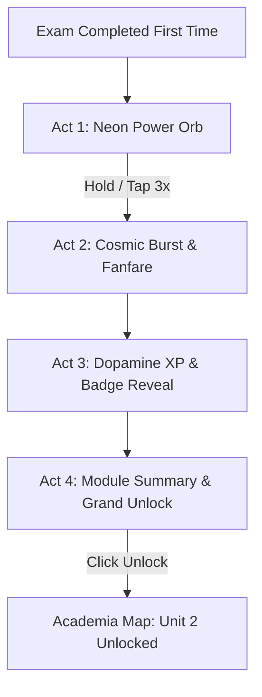

# Design Document: Fullscreen Epic Unit Completion Experience (`UnitCompletionScreen`)

**Date:** 2026-08-08  
**Status:** Approved  
**Target Component:** `src/components/UnitCompletionScreen.tsx`  

---

## 1. Overview & Objectives

Create a high-octane, full-screen, 4-act interactive celebration experience that triggers the **first time** a user completes the evaluation exam of any Unit (such as `u1-node12.5` for Unit 1).

The goal is to deliver an AAA game-like dopamine rush with particle explosions, interactive 3D orb charging, orchestral victory fanfares, rapid numerical XP counting, level-up badge reveals, and a seamless transition to unlocking the next Unit on the Academia map.

---

## 2. Trigger Logic & Persistence

- **Trigger Event:** Completion of the final evaluation exam node (e.g. `u1-node12.5`) with a passing score.
- **First-Time Guard:** Uses `localStorage` key `laclave_unit_1_celebrated = 'true'`.
  - **First Completion:** Launches `UnitCompletionScreen` in full-screen overlay (`fixed inset-0 z-[100]`).
  - **Subsequent Retries:** Bypasses full-screen celebration and renders standard star rating results modal.

---

## 3. The 4-Act Interactive Sequence

### Act 1: The Pulsing Neon Power Orb (`charge` stage)
- **Background:** Deep dark cosmic gradient (`#0b1c30` to `#070c14`) with animated floating particles and glowing ambient light matching Unit theme color (`#4648d4`).
- **Center Piece:** 3D glowing Neon Orb with 3 counter-rotating energy rings.
- **Instruction:** *"¡MANTÉN PRESIONADO PARA LIBERAR EL PODER DE LA UNIDAD!"*
- **Interaction:** User holds down on the Orb (or 3 firm taps).
  - Progress bar charges from 0% to 100%.
  - Haptic feedback pulses continuously.
  - Audio pitch riser (`playOrbeChargeRiser()`) ascends in pitch.

### Act 2: Cosmic Explosion & Fanfare (`burst` stage)
- **Visuals:** Flash of white light + 120-particle multi-burst confetti explosion using `canvas-confetti`.
- **Audio:** Polyphonic orchestral victory fanfare (`playUnitVictoryFanfare()`).

### Act 3: Dopamine XP & Level Up Badge (`rewards` stage)
- **XP Counter:** Rapid numerical counter ticking from `+0 XP` to `+100 XP` accompanied by fast `tick-tick-tick-ding!` audio.
- **Level Bar:** Animated fill of user's overall level progress bar.
- **Badge Reveal:** 3D rotating gold badge card:
  - **Title:** *"Gran Maestro de la Fisiología y Apoyo Vocal"*
  - **Subtitle:** *"Unidad 1 Conquistada al 100%"*

### Act 4: Module Summary & Grand Unlock (`unlock` stage)
- **Summary Cards:**
  - 12/12 Lessons Mastered
  - Vocal Range Registered & Synced
  - 100% Diagnostic Accuracy
- **Grand Action Button:**
  - *"¡DESBLOQUEAR UNIDAD 2: AFINACIÓN Y OÍDO MUSICAL! 🚀"*
- **Action:** Triggers portal sound effect, closes screen, updates state, and scrolls/focuses smoothly onto Unit 2 on the Academia map.

---

## 4. Audio Engine Extensions (`audioService.ts`)

Add 4 dedicated Web Audio API synthesizer methods:
1. `playOrbeChargeRiser(progress: number)` — Ascending frequency synth riser.
2. `playUnitVictoryFanfare()` — Multi-tone orchestral victory chord cascade.
3. `playXpTickSound()` — High-frequency rapid tick.
4. `playBadgeUnlockChime()` — Majestic metallic bell chime.

---

## 5. File Changes

| File Path | Action | Description |
|---|---|---|
| `src/components/UnitCompletionScreen.tsx` | **[NEW]** | Fullscreen 4-act interactive celebration component |
| `src/services/audioService.ts` | **[MODIFY]** | Add fanfare, charge riser, tick, and badge chime sounds |
| `src/components/LessonModal.tsx` | **[MODIFY]** | Trigger `UnitCompletionScreen` on first exam completion |
| `src/components/MainApp.tsx` | **[MODIFY]** | Handle transition and unit unlock state |
