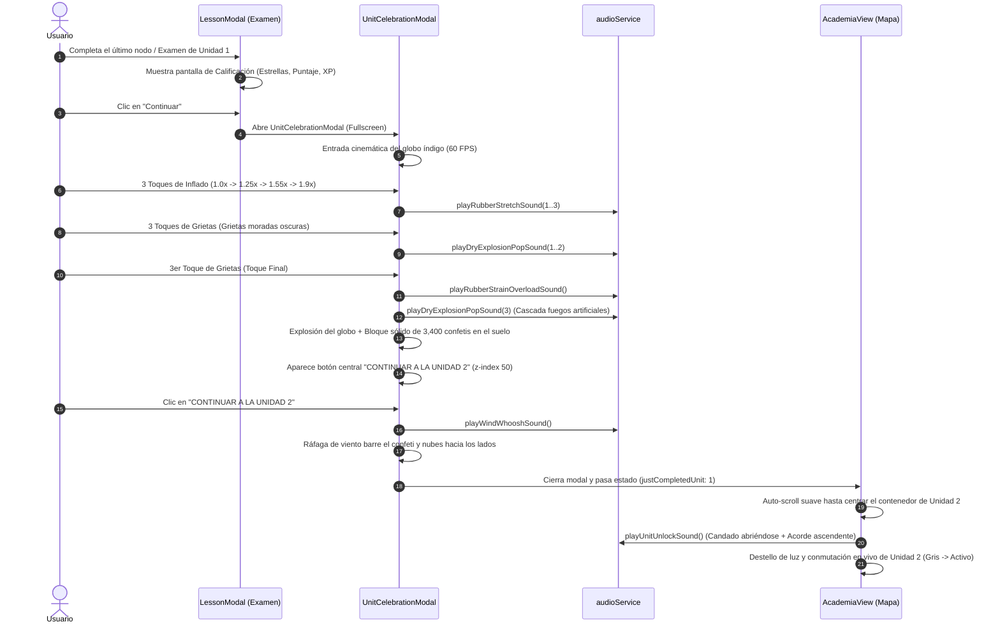

# Diseño de Integración: Flujo Completo de Culminación de la Unidad 1

**Fecha:** 2026-09-07  
**Estado:** Aprobado  
**Objetivo:** Conectar el examen final de la Unidad 1 con la pantalla cinemática de celebración del globo y finalizar en `AcademiaView` con auto-scroll suave y desbloqueo en vivo de la Unidad 2.

---

## 1. Resumen Ejecutivo
Actualmente, la pantalla cinemática del globo se diseñó e iteró con éxito en `/sandbox/unit` (fondo dorado de nubes 2D, mecha con física en "S", 3 toques de inflado con sonido de goma, 3 toques de resquebrajamiento con grietas moradas oscuras y estallidos secos, estallido final estilo fuegos artificiales, pared sólida de 3,400 confetis en el suelo y botón central de la Unidad 2).

Este diseño formaliza la integración de dicha pantalla en el flujo real de la aplicación, conectando el examen final en `LessonModal` y concluyendo con una transición cinemática de ráfaga de viento que desemboca en `AcademiaView`, donde la pantalla se desplaza suavemente hasta la Unidad 2 y la desbloquea en vivo con audio y efectos visuales.

---

## 2. Flujo Completo Paso a Paso

---

## 3. Especificación de Componentes y Cambios

### 3.1. `src/components/UnitCelebrationModal.tsx` [NUEVO]
- Componente modular modal fullscreen que encapsula la experiencia interactiva validada en `/sandbox/unit`.
- **Props:**
  - `isOpen: boolean`
  - `onComplete: () => void` (disparado tras la ráfaga de viento al pulsar "CONTINUAR A LA UNIDAD 2").
- **Estados:**
  - Ciclo de toques (0..6).
  - Estado `isPopped` (fuegos artificiales y pared de confeti).
  - Estado `isWindSweeping` (activa la ráfaga de viento horizontal que arrastra confeti y nubes antes de invocar `onComplete`).

### 3.2. `src/components/LessonModal.tsx` [MODIFICAR]
- Al terminar el examen de la Unidad 1 (`node.isExam` y `unitId === 1`), se muestra la pantalla existente de calificación/estrellas.
- Al pulsar el botón "Continuar" de la pantalla de calificación:
  - En lugar de cerrar directamente el modal, activa `showCelebrationModal = true`.
  - Al culminar la celebración (`onComplete`), cierra el `LessonModal` e invoca `onCompleteNode(node)` pasando la bandera de desbloqueo a la vista principal.

### 3.3. `src/components/AcademiaView.tsx` [MODIFICAR]
- Soporta la prop opcional o estado `unlockedUnitAnimationId?: number`.
- Contenedor de la Unidad 2 con `id="unit-card-2"`.
- Al montarse o recibir `unlockedUnitAnimationId === 2`:
  1. Espera 200ms para asegurar la renderización del DOM.
  2. Ejecuta `document.getElementById('unit-card-2')?.scrollIntoView({ behavior: 'smooth', block: 'center' })`.
  3. Tras 600ms (cuando el scroll finaliza en el centro), dispara `audioService.playUnitUnlockSound()`.
  4. Aplica una animación de pulso/resplandor brillante sobre el botón de la Unidad 2, activándolo formalmente en la interfaz.

### 3.4. `src/utils/audioService.ts` [MODIFICAR]
- **`playWindWhooshSound()`:** Sonido envolvente de ráfaga de viento suave con filtro pasabanda modulado.
- **`playUnitUnlockSound()`:** Sonido metálico de chasquido de candado liberándose seguido de un arpegio ascendente triunfal (`Do - Mi - Sol - Do`).

---

## 4. Plan de Pruebas y Validación
1. **Verificación Estática:** `npx tsc --noEmit` sin ningún error de tipos ni de sintaxis.
2. **Prueba en Sandbox (`/sandbox/unit`):** Validar que la transición de ráfaga de viento limpie el confeti hacia la derecha de forma fluida.
3. **Prueba End-to-End en Academia (`LessonModal` -> `AcademiaView`):**
   - Completar el examen de la Unidad 1.
   - Ver pantalla de calificación con estrellas y puntaje.
   - Pulsar "Continuar" y verificar el lanzamiento del globo cinemático.
   - Realizar los 6 toques hasta reventarlo.
   - Pulsar "CONTINUAR A LA UNIDAD 2" y verificar la ráfaga de viento, el auto-scroll hacia la Unidad 2 y su desbloqueo sonoro y visual en vivo.
